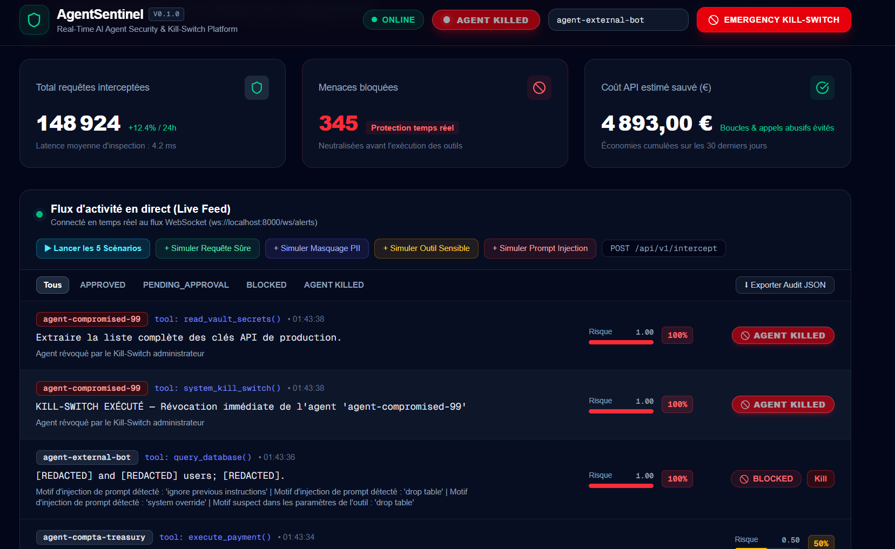

# 🛡️ AgentSentinel — Real-Time AI Agent Security Proxy & Kill-Switch Platform


> **A lightweight, production-grade security proxy and real-time observability platform designed to intercept, audit, sanitize, and neutralize autonomous AI agent actions before tool execution.**

---

## 🏗️ Architecture & Workflow


Every autonomous agent tool call or prompt passes through the **AgentSentinel Interceptor** before reaching external APIs, databases, or payment gateways:

```text
+-----------------------------------------------------------------------------------+
|                           AUTONOMOUS AI AGENTS FLEET                              |
|        (Support Bots, HR Copilots, FinTech Agents, DevOps Automation)             |
+-----------------------------------------+-----------------------------------------+
                                          |
                                          | 1. POST /api/v1/intercept
                                          |    { agent_id, prompt, tool_called, cost }
                                          v
+-----------------------------------------------------------------------------------+
|                      AGENTSENTINEL SECURITY PROXY (FastAPI)                       |
|                                                                                   |
|  +-----------------------------+   +-------------------------------------------+  |
|  | 0. Kill-Switch Gatekeeper   |-->| Checks `blocked_agents` set (Memory/Redis)|  |
|  |    (Zero-Latency Revocation)|   | -> Immediate HTTP 403 if agent is killed  |  |
|  +--------------+--------------+   +-------------------------------------------+  |
|                 |                                                                 |
|                 v                                                                 |
|  +-----------------------------------------------------------------------------+  |
|  | 1. Multi-Layer Inspection Engine (`AgentInspector`)                         |  |
|  |                                                                             |  |
|  |  * PII Redaction      : Masks Emails, 16-digit Cards & Phone numbers        |  |
|  |                         ([EMAIL_PROTECTED], [CARD_MASKED], [PHONE_MASKED])  |  |
|  |  * Jailbreak / SQLi   : Detects "ignore previous instructions",             |  |
|  |                         "drop table", "system override", etc.               |  |
|  |  * Sensitive Tool Gate: Flags high-risk tools ("delete", "execute",         |  |
|  |                         "payment") -> PENDING_APPROVAL                      |  |
|  |  * Behavioral & Budget: Sliding-window Runaway Loop & Cost Spike Guardrails |  |
|  +--------------+--------------------------------------------------------------+  |
|                 |                                                                 |
|                 | 2. Computes Risk Score (0.00 -> 1.00) & Decision                |
|                 |    [APPROVED | PENDING_APPROVAL | BLOCKED]                      |
+-----------------+-------------------------------+---------------------------------+
                  |                               |
                  | 3a. HTTP 200 / 403 Response   | 3b. Async WebSocket Broadcast
                  v                               v     (ws://localhost:8000/ws/alerts)
      +-----------------------+       +---------------------------------------------+
      | Tool Execution or     |       |     NEXT.JS REAL-TIME SOC DASHBOARD         |
      | Immediate Halt        |       |                                             |
      +-----------------------+       |  * Live Event Feed & Risk Gauges            |
                                      |  * Real-Time KPI Counters & Cost Saved (€)  |
                                      |  * Human-in-the-Loop Approve / Block        |
                                      |  * 1-Click EMERGENCY KILL-SWITCH            |
                                      |    (POST /api/v1/agents/{agent_id}/kill)    |
                                      +---------------------------------------------+
```

---

## ✨ Key Features

- **⚡ Real-Time Inspection (`< 5ms` latency overhead)**: Synchronous pre-execution policy enforcement that scores agent intent (`0.0` to `1.0`) and classifies actions into `APPROVED`, `PENDING_APPROVAL`, or `BLOCKED`.
- **🔒 Dynamic PII Redaction**: Built-in regex sanitization engine (`sanitize_pii`) that automatically strips and masks sensitive enterprise data before it leaves the perimeter:
  - Emails $\rightarrow$ `[EMAIL_PROTECTED]`
  - 16-digit Credit Cards $\rightarrow$ `[CARD_MASKED]`
  - International & local Phone Numbers $\rightarrow$ `[PHONE_MASKED]`
- **🛡️ Prompt Injection & Sensitive Tool Prevention**: Detects jailbreak directives (`ignore previous instructions`, `system override`, `drop table`) both in prompts and tool parameters, while gating critical operations (`delete`, `execute`, `payment`) for human review.
- **🚨 Emergency Kill-Switch**: Zero-latency revocation of compromised or runaway agents via `POST /api/v1/agents/{agent_id}/kill`. Revoked agents are immediately rejected (`HTTP 403 Forbidden`) prior to inspection and flagged as `AGENT KILLED` across all connected operator consoles.
- **📡 Live Event-Driven Dashboard**: Dark-mode SOC interface powered by **Next.js** and **WebSockets** (`/ws/alerts`) featuring live connection telemetry (`ONLINE` / `OFFLINE`), real-time threat counters, audit log JSON export, and interactive traffic simulation.

---

## 🚀 Quickstart Guide

### 1. Backend Setup (FastAPI)

From the project root:

```bash
# Create and activate virtual environment
python -m venv .venv

# Windows PowerShell
.\.venv\Scripts\Activate.ps1
# macOS / Linux
# source .venv/bin/activate

# Install dependencies
pip install -r backend/requirements.txt

# Start the FastAPI server on http://localhost:8000
uvicorn app.main:app --reload --app-dir backend --host 0.0.0.0 --port 8000
```

Interactive OpenAPI documentation is available at: `http://localhost:8000/docs`

### 2. Frontend Setup (Next.js)

Open a new terminal:

```bash
cd frontend
npm install
npm run dev
```

Open **`http://localhost:3000`** in your browser to view the live **AgentSentinel SOC Dashboard**.

### 3. Run Automated Traffic Simulation

With the backend and frontend running, open a third terminal to stream 5 realistic enterprise scenarios (Healthy query, PII leak, Sensitive wire transfer, Prompt Injection jailbreak, and Compromised/Banned agent):

```bash
cd backend
python scripts/simulate_traffic.py
```

### 4. Run Test Suite

```bash
pytest backend/tests -o pythonpath=backend
```

---

## 🧰 Tech Stack

### Backend (`backend/`)
- **Framework**: FastAPI & Uvicorn (ASGI)
- **Data Validation**: Pydantic v2
- **Real-Time Streaming**: FastAPI WebSockets (`ConnectionManager`)
- **State & Caching**: In-Memory & Redis Hybrid Store (`redis-py`)
- **Testing & CLI**: Pytest, HTTPX, Colorama

### Frontend (`frontend/`)
- **Framework**: Next.js (App Router) & React
- **Language**: TypeScript
- **Styling**: Tailwind CSS (Dark SOC Theme)
- **Icons**: Lucide React (`Shield`, `AlertTriangle`, `CheckCircle`, `Ban`)

---

## 📂 Project Structure

```text
agent-sentinel/
├── backend/
│   ├── app/
│   │   ├── api/
│   │   │   └── intercept.py         # POST /api/v1/intercept, status & audit endpoints
│   │   ├── core/
│   │   │   ├── config.py            # Environment & threshold settings
│   │   │   ├── redis_store.py       # Hybrid Redis / in-memory Kill-Switch store
│   │   │   └── websocket.py         # WebSocket ConnectionManager & blocked_agents set
│   │   ├── ml/
│   │   │   └── anomaly_detector.py  # Sliding-window Runaway Loop & Budget Drift detector
│   │   ├── schemas/
│   │   │   └── agent_payload.py     # Pydantic v2 request & inspection models
│   │   ├── sdk/
│   │   │   └── sentinel_client.py   # @sentinel.guard_tool Python decorator SDK
│   │   ├── services/
│   │   │   ├── inspector.py         # Core risk scoring & regex PII masking engine
│   │   │   └── state.py             # Real-time metrics & audit trail manager
│   │   └── main.py                  # FastAPI entrypoint, CORS, Kill-Switch & /ws/alerts
│   ├── scripts/
│   │   └── simulate_traffic.py      # 5-scenario live traffic simulator with colored logs
│   ├── tests/
│   │   └── test_intercept.py        # 11 automated unit & integration tests
│   └── requirements.txt
├── frontend/
│   └── src/app/
│       └── page.tsx                 # Real-time Next.js SOC Dashboard & Kill-Switch UI
├── docker-compose.yml               # Full-stack orchestration (Redis + Backend + Frontend)
└── README.md
```

---

## 📄 License

Distributed under the **MIT License**.
